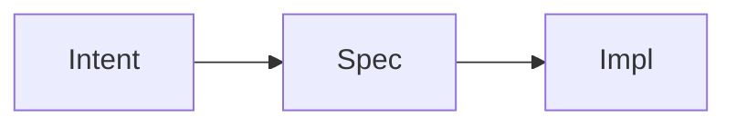

# GSE Slides

A Markdown-first presentation system with fixed typography and a layout engine that adapts structure, not font size.

GSE Slides is a Markdown-first presentation system inspired by
the restrained, content-first visual language of JYY's lecture slides.

You write content.
The renderer owns typography and layout.

> **Do not edit build artifacts**
>
> Do not edit dist/index.html.
>
> Do not edit exported PowerPoint.
>
> Edit slides.md and rebuild.

## Getting started

The fastest path is to copy the template directory and edit it:

```bash
cp -r templates my-talk          # deck.md + sample assets
pnpm slides dev my-talk/deck.md
```

| Where | What |
| ----- | ---- |
| `templates/deck.md` | Copy-me starting deck, with working examples of every layout |
| `docs/GUIDE.md` | Full usage guide (Chinese): commands, syntax, layout rules, troubleshooting |
| `examples/demo.md` | 18-slide reference deck covering every layout |
| `examples/overflow.md` | Deliberately too long, to demonstrate the build failure |
| `examples/mermaid.md` | Build-time Mermaid to SVG |
| `docs/gse-slides-spec.md` | Implementation spec this project was built from |

## Core principles

- Markdown is the single source of truth.
- HTML, PDF, and PPTX are build artifacts.
- Typography is fixed and never auto-shrinks.
- The layout engine adapts media and structure instead of font size.
- Images always keep aspect ratio and are never cropped.
- Build output is fully offline. No npm, node, or network is needed to present.

## How it works

```text
slides.md -> Markdown Parser -> Semantic Slide AST -> Layout Engine -> Reveal.js + fixed CSS theme -> dist/index.html -> optional export (slides.pdf / slides.pptx)
```

The parser turns Markdown into a semantic AST. The layout engine inspects each slide and picks a structure. The renderer emits one static HTML bundle.

## Install

Requires Node 20 or newer. Install dependencies, then add Chromium for PDF, PPTX, and visual lint:

```bash
pnpm install
pnpm exec playwright install chromium
```

## Usage

- `pnpm slides dev slides.md` starts a local dev server. It watches slides.md and assets/, rebuilds, and live reloads the browser.
- `pnpm slides build slides.md` writes dist/index.html and dist/assets/ (fully offline).
- `pnpm slides pdf slides.md` writes dist/slides.pdf (one slide per PDF page).
- `pnpm slides pptx slides.md` writes dist/slides.pptx (one 2048x1536 screenshot per PowerPoint slide).
- `pnpm slides lint slides.md` checks missing assets, overflowing slides, and content density. It fails loudly instead of shrinking fonts.

## Markdown syntax

Front matter at the top of the file:

```markdown
---
title: Introduction to Systems
author: J. Doe
theme: gse
aspect: 16:9
slideNumber: true
---
```

Split slides with a line containing only three hyphens:

```markdown
# First slide

---

## Second slide
```

Headings, lists, blockquote, and code fences:

````markdown
# Slide title

## Subtitle

- first point
- second point

> A short, load-bearing quote.

```js
const answer = 42;
```
````

Math via KaTeX, inline and display:

```markdown
Inline $E = mc^2$ and display:

$$
\int_0^1 x^2 \, dx = \frac{1}{3}
$$
```

Images keep aspect ratio and are never cropped:

```markdown

```

Tables:

```markdown
| Stage  | Cost   |
| ------ | ------ |
| Parse  | Low    |
| Render | Medium |
```

Mermaid diagrams are rendered to SVG at build time, never at runtime, so the HTML, PDF, and PPTX stay identical:

````markdown

````

## Layout directives

Directives are optional HTML comments at the top of a slide. They are overrides for the roughly 10% of cases the automatic layout engine cannot infer.

```markdown
<!-- layout: auto -->
<!-- layout: text -->
<!-- layout: figure -->
<!-- layout: image-right -->
<!-- layout: image-left -->
<!-- layout: image-bottom -->
<!-- layout: gallery -->
<!-- layout: middle -->
<!-- layout: title -->
<!-- image-width: 40% -->
```

`image-width` accepts only these values: 30%, 35%, 40%, 45%, 50%, 60%, 70%, 80%, 90%.

You cannot set pixel positions, font sizes, margins, or colors in Markdown. Those belong to the fixed CSS theme.

## Automatic image layout

- No image: text layout.
- One image and almost no text: figure layout.
- One image with text: automatic left/right split (text about 56%, image about 40%).
- Portrait images prefer left/right.
- Landscape images with light text prefer top/bottom, with the image up to 60% of body height.
- Ultra-wide images (ratio above 2.5, such as a pipeline strip) always go top/bottom; a narrow side column would make them unreadable.
- Two images: side-by-side grid.
- Three to four images: 2x2 grid with a density warning.
- More than four images warns; six or more errors unless `layout: gallery` is set.

## Fixed typography

Font sizes are constant across ALL slides:

| Element | Size |
| ------- | ---- |
| h1      | 60px |
| h2      | 48px |
| body    | 32px |
| code    | 28px |

The theme accent color is `rgb(106, 0, 95)`.

Overflow is resolved by changing layout or by failing the build with an actionable message. It is never resolved by shrinking text.

## Project structure

```text
bin/slides.mjs          CLI: build / dev / pdf / pptx / lint
src/parser              front matter, markdown, layout directives
src/compiler            semantic AST, layout candidates, compile pipeline
src/render              HTML, image sizing, Mermaid to SVG, template
src/export              PDF and PPTX exporters
src/lint                assets, overflow probing, density
src/theme/gse.css       the only source of visual truth
templates/deck.md       copy-me starting deck
examples/demo.md        reference deck covering every layout
tests/                  unit tests + visual baseline
docs/GUIDE.md           usage guide
dist/                   build output (never edit)
```

## Testing

```bash
pnpm test         # parser and layout unit tests
pnpm test:visual  # Playwright pixel-diff regression
```

`pnpm test` runs parser and layout unit tests. `pnpm test:visual` compares current screenshots against tests/visual/baseline.

## Design philosophy

The pipeline is always the same:

```text
Content -> Semantic AST -> Layout -> Renderer
```

CSS owns visuals. The layout engine owns structure. Playwright owns verification. There is no AI-flavored decoration: no gradients, no glassmorphism, no cards, no shadows, and no animated timelines.
