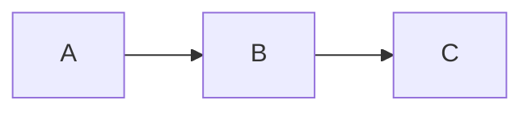

# GSE Slides 实现规格

## 0. 项目目标

实现一个极简、稳定、可复现的 slides 工具：

```text
slides.md
   ↓
Markdown Parser
   ↓
Semantic Slide AST
   ↓
Layout Engine
   ↓
Reveal.js + 固定 CSS Theme
   ↓
dist/index.html
   ↓
可选导出
├── slides.pdf
└── slides.pptx
```

核心理念：

```text
Markdown 是唯一 source of truth。

HTML / PDF / PPTX 都只是 build artifacts。
```

不要实现 PowerPoint 式的自由排版。

不要允许用户在 Markdown 中设置：

```text
x = 318
y = 194
font-size = 29
margin-left = 13
```

用户只应该描述：

```text
标题
正文
列表
引用
代码
图片
图片位置偏好
必要时的左右分栏
```

所有字号、间距、颜色、图片约束由 theme 和 layout engine 统一决定。

---

## 1. 技术路线

V1 使用：

```text
Node.js 20+
Reveal.js
markdown-it
gray-matter
highlight.js
KaTeX
Vite
Playwright
PptxGenJS
sharp
```

推荐包管理器：

```text
pnpm
```

不要使用 React/Vue。

这个项目本质只是：

```text
Markdown compiler + CSS theme + Reveal.js runtime
```

没必要引入组件框架。

---

## 2. 项目目录

最终项目结构：

```text
gse-slides/
├── package.json
├── pnpm-lock.yaml
├── README.md
├── vite.config.js
│
├── bin/
│   └── slides.mjs
│
├── src/
│   ├── parser/
│   │   ├── markdown.mjs
│   │   ├── frontmatter.mjs
│   │   └── directives.mjs
│   │
│   ├── compiler/
│   │   ├── compile.mjs
│   │   ├── slide-ast.mjs
│   │   └── layouts.mjs
│   │
│   ├── render/
│   │   ├── html.mjs
│   │   ├── image-layout.mjs
│   │   └── template.html
│   │
│   ├── export/
│   │   ├── pdf.mjs
│   │   └── pptx.mjs
│   │
│   ├── lint/
│   │   ├── overflow.mjs
│   │   └── assets.mjs
│   │
│   └── theme/
│       ├── gse.css
│       └── highlight.css
│
├── examples/
│   ├── demo.md
│   └── assets/
│       ├── architecture.svg
│       └── screenshot.png
│
├── tests/
│   ├── parser.test.mjs
│   ├── layout.test.mjs
│   └── visual/
│
└── dist/
```

---

## 3. CLI

必须提供：

```bash
pnpm slides dev slides.md
```

行为：

```text
启动本地 HTTP server
监听 slides.md
监听 assets/
修改后自动 rebuild
浏览器自动刷新
```

构建：

```bash
pnpm slides build slides.md
```

输出：

```text
dist/
├── index.html
└── assets/
```

PDF：

```bash
pnpm slides pdf slides.md
```

输出：

```text
dist/slides.pdf
```

PPT：

```bash
pnpm slides pptx slides.md
```

输出：

```text
dist/slides.pptx
```

检查：

```bash
pnpm slides lint slides.md
```

检查：

```text
资源是否存在
字体是否可用
图片是否读取成功
slide 是否 overflow
是否存在过多内容
是否存在无法自动排版的页面
```

如果无法正常排版：

不要偷偷缩小字体。

必须显式失败并报告：

```text
Slide 14 overflowed vertically by 86px.

Possible fixes:
- split this slide
- reduce bullet count
- use layout: image-right
```

---

## 4. Markdown 基本语法

一个完整文件：

```markdown
---
title: 生成式软件工程
author: Your Name
theme: gse
aspect: 4:3
slideNumber: true
---

# 生成式软件工程

## Generative Software Engineering

Your Name

---

# 软件工程

## 怎么把一件大事做成？

- 拆解大问题
- 建立反馈
- 持续验证
- 让错误尽早暴露

---

# Everything is Code

## Slides 也应该是代码

- Markdown 是 source of truth
- HTML 是渲染结果
- 图片是资源
- PPTX 是导出格式

> 保存可编辑、可 diff、可复现的源代码。

---

# Agentic Software Engineering

## 人定义目标，Agent 搜索实现


```

分页只使用：

```markdown
---
```

除了文件最前面的 YAML front matter。

不要发明复杂分页语法。

---

## 5. Slide 的语义模型

内部必须先生成 AST，不要直接字符串替换 HTML。

例如：

```js
{
  type: "slide",
  title: "软件工程",
  subtitle: "怎么把一件大事做成？",
  blocks: [
    {
      type: "list",
      items: [...]
    },
    {
      type: "image",
      src: "assets/foo.svg"
    }
  ],
  directives: {},
  layout: "auto"
}
```

至少识别：

```text
heading1
heading2
paragraph
unordered-list
ordered-list
blockquote
code
math
image
table
```

layout engine 只能读 AST。

CSS 不参与内容解析。

---

## 6. 页面尺寸

V1 默认：

```text
1024 × 768
4:3
```

Reveal.js：

```js
Reveal.initialize({
  width: 1024,
  height: 768,

  margin: 0,
  center: false,

  controls: false,
  progress: false,

  hash: true,
  slideNumber: true,

  transition: "none",
  backgroundTransition: "none"
});
```

注意：

Reveal 可以整体缩放页面适应浏览器。

但是 slide 内部排版的逻辑尺寸永远是：

```text
1024 × 768
```

绝对禁止：

```text
某页文字多
→ font-size 自动从 32px 降到 26px
```

字体大小必须跨 slide 恒定。

未来允许：

```yaml
aspect: 16:9
```

但 V1 优先把 4:3 做稳定。

---

## 7. GSE/JYY Theme

主题文件：

```text
src/theme/gse.css
```

CSS 中首先定义 tokens：

```css
:root {
  --gse-bg: #ffffff;
  --gse-text: #222222;
  --gse-muted: #555555;

  --gse-accent: rgb(106, 0, 95);
  --gse-border: #dddddd;
  --gse-code-bg: #eeeeee;

  --gse-font-title:
    "Lato",
    "Noto Sans CJK SC",
    "Microsoft YaHei",
    "SimHei",
    sans-serif;

  --gse-font-body:
    "Lato",
    "Noto Sans CJK SC",
    "PingFang SC",
    "Microsoft YaHei",
    "STHeiti",
    sans-serif;

  --gse-font-serif:
    "STKaiti",
    "KaiTi",
    serif;

  --gse-font-code:
    "Inconsolata",
    "JetBrains Mono",
    "Noto Sans Mono CJK SC",
    monospace;

  --gse-h1: 60px;
  --gse-h2: 48px;
  --gse-body: 32px;
  --gse-code: 28px;
  --gse-slide-number: 26px;

  --gse-padding-x: 34px;
  --gse-padding-y: 30px;

  --gse-gap-xs: 10px;
  --gse-gap-sm: 16px;
  --gse-gap-md: 24px;
  --gse-gap-lg: 36px;
}
```

---

## 8. 基础排版

实现：

```css
.reveal {
  background: var(--gse-bg);
  color: var(--gse-text);
}

.reveal .slides {
  text-align: left;
  font-weight: 300;

  border: 1.5px solid var(--gse-border);
  border-radius: 7px;
}

.reveal .slides section {
  box-sizing: border-box;

  width: 100%;
  height: 100%;

  padding:
    var(--gse-padding-y)
    var(--gse-padding-x);
}
```

标题：

```css
.reveal h1 {
  margin: 0 0 20px;
  padding: 0 25px;

  font-family: var(--gse-font-title);
  font-size: var(--gse-h1);
  font-weight: 400;
  line-height: 1.2;

  color: #222;
}
```

二级标题：

```css
.reveal h2 {
  margin: 0 0 24px;
  padding: 0 25px 6px;

  font-family: var(--gse-font-title);
  font-size: var(--gse-h2);
  font-weight: 400;
  line-height: 1.2;

  border-bottom:
    2px solid var(--gse-accent);
}
```

正文：

```css
.reveal p,
.reveal li {
  font-family: var(--gse-font-body);
  font-size: var(--gse-body);
  font-weight: 300;
  line-height: 1.35;
}
```

列表：

```css
.reveal ul,
.reveal ol {
  margin-top: 12px;
  margin-bottom: 12px;
}

.reveal li + li {
  margin-top: 10px;
}
```

不要人为把 bullet 做得很花。

使用浏览器默认或非常简单的：

```text
•
◦
▪
```

即可。

---

## 9. 强调文字

Markdown：

```markdown
**重要结论**
```

CSS：

```css
strong {
  font-weight: 600;
}
```

默认不要彩色。

如果确实需要 accent：

```markdown
<span class="accent">Intent</span>
```

CSS：

```css
.accent {
  color: var(--gse-accent);
}
```

整个系统只能有一个主要 accent color：

```text
rgb(106, 0, 95)
```

禁止每页出现不同颜色。

---

## 10. Quote

Markdown：

```markdown
> 保存可编辑、可 diff、可复现的源代码。
```

普通引用：

```css
.reveal blockquote {
  margin: 28px 50px;
  padding: 0;

  background: transparent;
  box-shadow: none;

  color: #444;
}

.reveal blockquote p {
  font-family: var(--gse-font-serif);
  font-size: 32px;
}
```

如果页面使用：

```html
<section class="middle">
```

则：

```css
.middle {
  display: flex !important;
  flex-direction: column;
  justify-content: center;
}

.middle blockquote {
  text-align: center;
  color: var(--gse-accent);
}
```

---

## 11. Code

代码：

```css
.reveal pre {
  width: auto;

  margin: 18px 25px;
  padding: 14px 18px;

  border-radius: 8px;

  background: var(--gse-code-bg);

  box-shadow: none;
}

.reveal pre code {
  max-height: 520px;

  font-family: var(--gse-font-code);
  font-size: var(--gse-code);
  line-height: 1.35;
}
```

代码块绝不自动缩小字体。

代码过长：

```text
build fail
```

提示用户拆页。

---

## 12. 图片设计原则

这是系统重点。

用户正常只写：

```markdown

```

不要要求用户写：

```html

```

图片由 layout engine 自动处理。

所有图片：

```css
.slide-image {
  display: block;

  max-width: 100%;
  max-height: 100%;

  object-fit: contain;
}
```

永远：

```text
contain
```

绝不默认 crop。

---

## 13. 自动图片布局

每一页解析完成后统计：

```text
imageCount
textBlocks
bulletCount
codeBlockCount
image aspect ratio
```

然后决定 layout。

### Case A：没有图片

```text
layout = text
```

正常文本流。

### Case B：只有一张图，几乎没有文字

例如：

```markdown
# System Architecture


```

使用：

```text
layout = figure
```

结构：

```html
<section class="layout-figure">
  <h1>...</h1>

  <div class="figure-box">
    
  </div>
</section>
```

CSS：

```css
.figure-box {
  height: 610px;

  display: flex;
  align-items: center;
  justify-content: center;
}

.figure-box img {
  max-width: 92%;
  max-height: 100%;
  object-fit: contain;
}
```

如果同时存在 H2：

动态从 figure-box 高度中减去标题占用空间。

不要修改字号。

---

## 14. 一张图 + 正文：自动分栏

这是默认行为。

例如：

```markdown
# Agent Workflow

## Feedback Loop

- Agent 生成
- Tool 执行
- Validator 检查
- 根据结果继续修改


```

自动变成：

```text
┌──────────────────────────────────────────────┐
│ Agent Workflow                               │
│ Feedback Loop ───────────────────────────── │
│                                              │
│ • Agent 生成           ┌─────────────────┐   │
│ • Tool 执行            │                 │   │
│ • Validator 检查       │      Image      │   │
│ • 根据结果继续修改     │                 │   │
│                        └─────────────────┘   │
└──────────────────────────────────────────────┘
```

默认比例：

```text
text 56%
gap   4%
image 40%
```

CSS：

```css
.layout-split .slide-body {
  display: grid;

  grid-template-columns:
    minmax(0, 1.4fr)
    minmax(0, 1fr);

  gap: 34px;

  align-items: center;
}
```

右侧：

```css
.layout-split .media {
  height: 100%;

  display: flex;
  justify-content: center;
  align-items: center;
}

.layout-split .media img {
  max-width: 100%;
  max-height: 100%;
  object-fit: contain;
}
```

---

## 15. 图片方向自动判断

使用 `sharp` 获取：

```text
width
height
aspectRatio
```

SVG 读取：

```text
width/height
或
viewBox
```

规则：

```text
ratio < 0.80
→ portrait

0.80 <= ratio <= 1.25
→ square-ish

ratio > 1.25
→ landscape
```

如果 portrait：

优先：

```text
text-left + image-right
```

图片列：

```text
36% ~ 40%
```

如果 landscape，并且正文较少：

优先：

```text
text-top
image-bottom
```

例如：

```text
标题
副标题
──────────────

• point
• point

┌───────────────────────────────┐
│            IMAGE              │
└───────────────────────────────┘
```

图片最大可占：

```text
页面正文区高度的 60%
```

如果 landscape 但文字很多：

仍然使用左右分栏。

---

## 16. 两张图片

如果一页有两张图片：

```markdown
# Comparison


```

自动：

```text
┌─────────────────┬─────────────────┐
│                 │                 │
│     before      │      after      │
│                 │                 │
└─────────────────┴─────────────────┘
```

CSS：

```css
.image-grid-2 {
  display: grid;
  grid-template-columns: 1fr 1fr;
  gap: 28px;
}
```

两张图片统一使用：

```text
contain
```

且视觉区域尺寸一致。

禁止根据原始像素大小决定显示大小。

---

## 17. 三到四张图

允许：

```text
2 × 2
```

但优先提醒用户：

```text
一页包含 3/4 张图，建议确认信息密度是否过高。
```

超过四张：

默认：

```text
lint warning
```

六张以上：

```text
build error
```

除非用户显式指定：

```html
<!-- layout: gallery -->
```

---

## 18. 手动 override

自动布局应该覆盖 90% 场景。

必要时允许非常少量的 HTML comment directives。

例如：

```markdown
<!-- layout: image-right -->

# Architecture

- Frontend
- Backend
- Database


```

支持：

```text
layout: auto
layout: text
layout: figure
layout: image-right
layout: image-left
layout: image-bottom
layout: gallery
layout: middle
```

还可以：

```markdown
<!-- image-width: 42% -->
```

但仅允许：

```text
30%
35%
40%
45%
50%
60%
70%
80%
90%
```

不要允许随意写像素。

---

## 19. 不允许手动设置字体

Markdown 中即使出现：

```html
<span style="font-size:17px">
```

lint 也应该 warning：

```text
Inline font-size is discouraged.
Use semantic layout instead.
```

主题必须稳定。

---

## 20. 自动布局不是“自动缩字”

这是必须坚持的设计原则：

```text
固定 typography
+
自适应 media
+
必要时改变 layout
```

而不是：

```text
内容多
↓
什么都缩小
↓
勉强塞进去
```

决策优先级：

```text
1. 调整图片尺寸
2. figure → split
3. split → stacked
4. 提示拆页
```

最后一步：

```text
build fail
```

绝不：

```text
font-size: 22px
```

---

## 21. 使用真实浏览器做 layout validation

不要只通过字符数估算是否 overflow。

构建过程中启动 Playwright。

每页真正渲染，然后读取：

```js
element.scrollHeight
element.clientHeight
element.scrollWidth
element.clientWidth
```

必须保证：

```js
scrollHeight <= clientHeight
scrollWidth <= clientWidth
```

如果不满足：

layout engine 可以尝试候选布局。

例如：

```text
Candidate 1
image-bottom

失败
↓

Candidate 2
image-right

成功
↓

使用 image-right
```

---

## 22. Auto Layout Candidate Strategy

一张图时：

```text
if image only:
    figure

elif portrait:
    image-right
    image-left
    image-bottom

elif landscape && text is light:
    image-bottom
    image-right

else:
    image-right
    image-bottom
```

依次实际渲染。

第一个不 overflow 的 layout 即为最终 layout。

如果全部失败：

```text
ERROR: slide cannot fit with fixed typography.
```

这比用字符数量猜测可靠得多。

---

## 23. 图片尺寸不要依赖屏幕

图片 CSS 不能：

```css
width: 30vw;
height: 50vh;
```

必须依赖 slide logical size。

使用：

```text
%
grid
flex
max-width
max-height
```

因为 Reveal 会统一缩放整个：

```text
1024 × 768
```

stage。

这样不同电脑显示完全一致。

---

## 24. 标题页

Markdown：

```markdown
<!-- layout: title -->

# 生成式软件工程

## Generative Software Engineering

Your Name

南京大学
```

效果：

```text


        生成式软件工程

     Generative Software Engineering


              Your Name

               南京大学


```

但保持 JYY 风格：

```text
白底
黑字
无渐变
无大面积装饰
无卡片
无阴影
```

不要做“AI 风 PPT”。

---

## 25. Section Divider

允许：

```markdown
<!-- layout: middle -->

# Software Engineering
```

得到页面中央的大标题。

CSS：

```css
.layout-middle {
  display: flex !important;
  justify-content: center;
  align-items: center;
}

.layout-middle h1 {
  width: 100%;
  text-align: center;
}
```

---

## 26. HTML 模板

基本结构：

```html
<!doctype html>
<html lang="zh-CN">

<head>
  <meta charset="UTF-8" />

  <meta
    name="viewport"
    content="width=device-width, initial-scale=1.0"
  />

  <title>{{ title }}</title>

  <link
    rel="stylesheet"
    href="./assets/reveal.css"
  />

  <link
    rel="stylesheet"
    href="./assets/gse.css"
  />
</head>

<body>

<div class="reveal">

  <div class="slides">
    {{ slides }}
  </div>

</div>

<script src="./assets/reveal.js"></script>

<script>
Reveal.initialize({
  width: 1024,
  height: 768,

  center: false,
  margin: 0,

  controls: false,
  progress: false,

  hash: true,

  slideNumber: true,

  transition: "none"
});
</script>

</body>

</html>
```

构建后的 HTML 必须：

```text
无需 npm
无需 node
无需联网
```

直接：

```bash
python -m http.server
```

即可演示。

最好最终连 CDN 都不要依赖。

---

## 27. 数学公式

支持：

```markdown
$$
f(x) = \sum_i x_i
$$
```

使用 KaTeX。

inline：

```markdown
复杂度为 $O(n \log n)$。
```

公式字号跟正文协调。

不要为了公式单独改变 slide typography。

---

## 28. Mermaid

V1 可选支持。

Markdown：

````markdown

````

构建阶段转 SVG：

```text
Mermaid
  ↓
SVG
  ↓
普通 image block
```

不要运行时再渲染 Mermaid。

这样 PPT/PDF/HTML 完全一致。

---

## 29. 远程图片

默认不推荐：

```markdown

```

因为无法保证复现。

如果遇到远程图片：

构建时：

```text
下载
↓
hash
↓
cache
↓
写入 dist/assets
```

最终 HTML 不允许依赖远程图片。

也可以提供：

```yaml
remoteAssets: false
```

默认 false。

---

## 30. PPTX 导出

V1 不追求 PPT 内部文字可编辑。

HTML 是真正渲染源。

PPTX 的目标是：

```text
视觉 100% 一致
```

流程：

```text
Reveal HTML
↓
Playwright
↓
逐页截图
↓
PptxGenJS
↓
一页截图对应一页 PowerPoint slide
```

截图分辨率：

```text
2048 × 1536
```

即：

```text
2× logical resolution
```

PPTX 页面比例：

```text
4:3
```

每张图片：

```text
x = 0
y = 0
w = full slide
h = full slide
```

这样：

```text
HTML
PDF
PPT
```

三者排版不会漂移。

因为 Markdown 才是 source of truth，所以“不方便在 PowerPoint 里改字”是可接受的设计。

修改：

```text
slides.md
```

重新 build 即可。

---

## 31. PDF 导出

使用 Playwright。

优先使用 Reveal.js print 模式。

保证：

```text
一页 slide
=
一页 PDF
```

背景图、代码高亮、SVG、公式全部保留。

---

## 32. Visual Regression Test

建立：

```text
examples/demo.md
```

至少包括：

```text
纯标题
标题 + bullet
两级列表
引用
代码
公式
横图
竖图
图 + 文字
两图
middle page
超长页
```

运行：

```bash
pnpm test:visual
```

Playwright 将每页截图：

```text
tests/visual/current/
```

第一次确认后保存：

```text
tests/visual/baseline/
```

以后修改 CSS：

```text
pixel diff
```

防止：

```text
改一个 margin
→ 整套 slides 全漂
```

---

## 33. Overflow Linter

每页必须检测：

```text
body overflow
code overflow
image overflow
heading overflow
```

如果只有图片尺寸造成 overflow：

自动缩图片。

如果文本 overflow：

不要缩字号。

输出：

```text
Slide 7
------------
Vertical overflow: 73px

Likely causes:
- 8 top-level bullets
- 3 nested bullets

Suggestion:
split into two slides.
```

---

## 34. 内容密度 warning

不是强制，但建议：

```text
H1 > 24 Chinese chars
→ warning

H2 > 32 Chinese chars
→ warning

top-level bullets > 6
→ warning

total bullets > 10
→ warning

paragraph chars > 350
→ warning
```

只是 warning。

不要擅自修改用户内容。

---

## 35. Markdown 示例

`examples/demo.md`：

```markdown
---
title: Generative Software Engineering
author: Your Name
theme: gse
aspect: 4:3
---

<!-- layout: title -->

# Generative Software Engineering

## 软件工程，在 AI 时代重新开始

Your Name

---

# 软件工程

## 怎么把一件大事做成？

- 明确目标
- 把未知拆成便宜的实验
- 建立反馈
- 尽早暴露错误

工程能力，是让一个系统持续向真实结果收敛。

---

# Intent → Spec → Impl

## 实现正在快速变便宜

- Intent：到底想解决什么问题？
- Spec：成功意味着什么？
- Impl：怎样让机器做到？

> Impl 可以外包，验收标准不能一起外包。

---

# Feedback Loop

## Agent 不应该工作在真空里

- Generate
- Execute
- Validate
- Observe
- Iterate


---

# Repository

## Everything is Code

```text
slides.md
   ↓
compiler
   ↓
HTML
   ↓
browser
```

- Markdown 是 source of truth
- 所有输出都可以重新生成

---

<!-- layout: middle -->

# Build systems, not screenshots.
```

---

## 36. README 必须解释的核心原则

README 开头写清楚：

```text
GSE Slides is a Markdown-first presentation system inspired by
the restrained, content-first visual language of JYY's lecture slides.

You write content.
The renderer owns typography and layout.
```

然后明确：

```text
Do not edit dist/index.html.

Do not edit exported PowerPoint.

Edit slides.md and rebuild.
```

---

## 37. 第一版不要实现的功能

明确不做：

```text
拖拽
GUI 编辑器
自由定位
动画时间线
几十种 theme
gradient
glassmorphism
card system
自动 AI 改写文字
自动 AI 美化
复杂 component DSL
```

Reveal fragment 可以暂时不支持。

V1 的核心只有：

```text
Markdown
fixed typography
simple slides
automatic images
reliable export
```

---

## 38. 实施顺序

严格按以下顺序实现：

```text
Phase 1
Markdown → basic Reveal HTML

Phase 2
实现 gse.css
确保 text-only slides 稳定

Phase 3
构建 Slide AST

Phase 4
实现 image metadata reader
实现 figure / image-right / image-bottom / grid

Phase 5
Playwright overflow validator
实现自动 layout candidate selection

Phase 6
watch + dev server

Phase 7
PDF export

Phase 8
PPTX screenshot export

Phase 9
visual regression tests

Phase 10
README + demo.md
```

不要一开始同时实现所有特性。

---

## 39. Definition of Done

项目只有满足以下条件才算完成：

```text
[ ] demo.md 可以生成完整 HTML slides

[ ] HTML 完全离线可运行

[ ] 标题字号所有页面一致

[ ] 正文字号所有页面一致

[ ] 不存在自动缩小文字

[ ] 单图页面自动调整图片大小

[ ] 图文页面能自动变成合理分栏

[ ] 横图能优先使用上下布局

[ ] 竖图能优先使用左右布局

[ ] 两图能够自动并排

[ ] 图片永远保持 aspect ratio

[ ] 图片不会被默认 crop

[ ] 页面 overflow 能被检测

[ ] overflow 无法解决时 build 明确失败

[ ] Markdown 修改后 dev server 自动刷新

[ ] PDF 与 HTML 视觉一致

[ ] PPTX 与 HTML 视觉一致

[ ] npm/pnpm build 一条命令可复现

[ ] examples/demo.md 覆盖主要 layout
```

---

## 40. 最重要的架构原则

实现过程中始终保持：

```text
Content
↓
Semantic AST
↓
Layout
↓
Renderer
```

绝对不要写成：

```text
Markdown
↓
大量 regex
↓
巨大 HTML 字符串
```

也不要：

```text
CSS 根据内容碰运气
```

Markdown 描述语义。

Layout engine 负责结构。

CSS 负责视觉。

Playwright 负责验证。

Renderer 负责输出。

最终要达到的体验是：

```markdown
# 一个问题

## 为什么值得讨论？

- 原因一
- 原因二
- 原因三


```

然后系统稳定地得到：

```text
简洁
统一
可读
无 AI 味
接近 JYY / 生成式软件工程课程风格
```

而不是让用户成为 PowerPoint 排版员。
