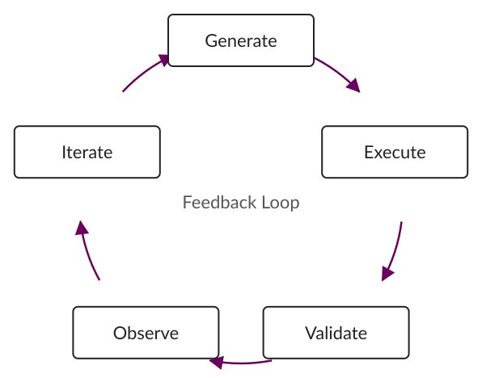
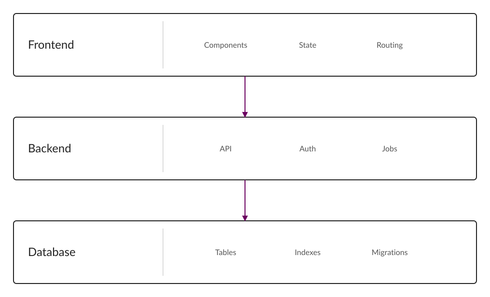
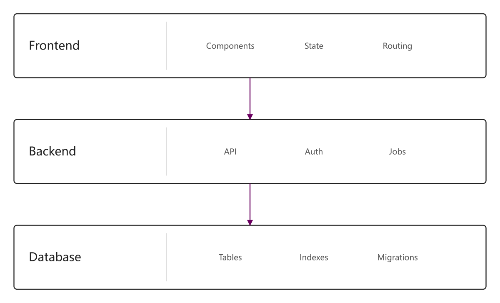
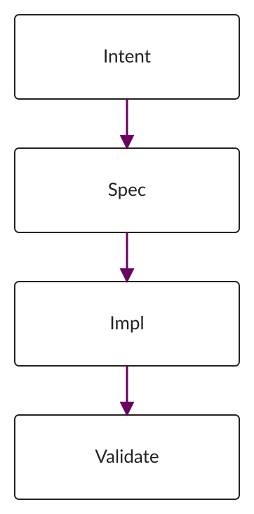
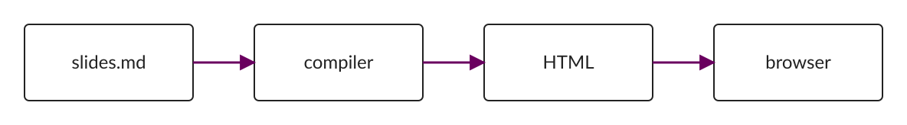
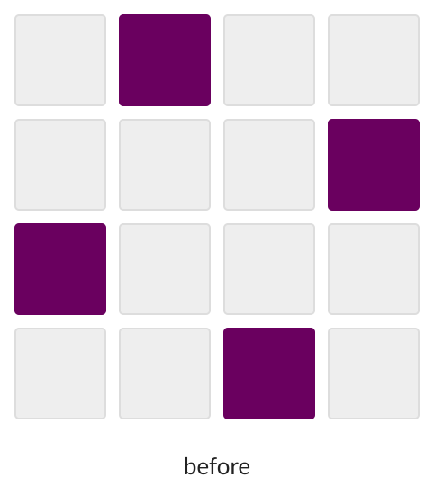
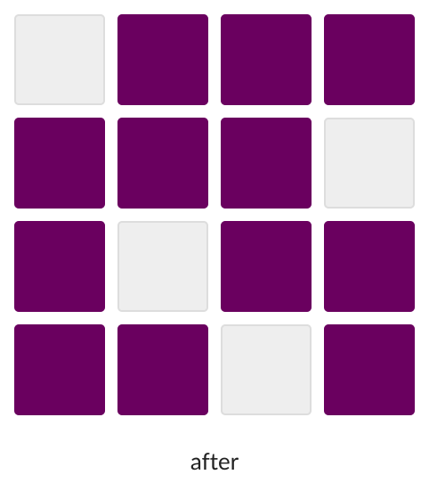

<!-- layout: title -->

# Generative Software Engineering

## 软件工程，在 AI 时代重新开始

Your Name

南京大学

---

# 软件工程

## 怎么把一件大事做成？

- 明确目标
- 把未知拆成便宜的实验
- 建立反馈
- 尽早暴露错误

工程能力，是让一个系统持续向真实结果收敛。

---

# Intent → Spec → Impl

## 实现正在快速变便宜

- Intent：到底想解决什么问题？
- Spec：成功意味着什么？
- Impl：怎样让机器做到？

> Impl 可以外包，验收标准不能一起外包。

---

# Feedback Loop

## Agent 不应该工作在真空里

- Generate
- Execute
- Validate
- Observe
- Iterate



---

# Repository

## Everything is Code

```text
slides.md
   ↓
compiler
   ↓
HTML
   ↓
browser
```

- Markdown 是 source of truth
- 所有输出都可以重新生成

---

<!-- layout: middle -->

# Build systems, not screenshots.

---

# System Architecture



---

# 位图也只是一张图片

## sharp 读取尺寸，排版规则完全一致

- PNG / JPEG / SVG 走同一条路径
- 永远 contain，永远不裁剪
- 不需要写 width / height



---

# Agent Workflow

## 人定义目标，Agent 搜索实现

- 人只负责 Intent
- Spec 变成可执行的验收
- Impl 由 Agent 搜索
- Validator 给出反馈



---

# Code Is the Source of Truth

## 一条命令即可复现

- slides.md 描述内容
- theme 统一决定排版
- layout engine 只决定结构
- build 负责生成产物



---

<!-- layout: image-left -->

# 同一张图，两种分栏

## 方向由 layout engine 决定，也可以显式指定

- 自动布局优先 image-right
- 需要时用 directive 改为 image-left
- 图片始终 contain，永不裁剪


---

# Before / After

## 同一份内容，结构化之后的差别





---

# 复杂度

## 固定排版，自适应媒体

时间复杂度为 $O(n \log n)$，并且常数很小。

$$
T(n) = 2T(n/2) + O(n)
$$

---

# 三种输出

## 一份 Markdown，三种产物

| 产物 | 用途 | 是否可编辑 |
| ---- | ---- | ---------- |
| HTML | 现场演讲 | 否 |
| PDF | 归档分发 | 否 |
| PPTX | 对外交付 | 否 |

---

<!-- layout: image-bottom -->

# 离线演示

## 构建之后不依赖任何网络

- 无需 npm
- 无需 node
- 无需 CDN


---

<!-- layout: gallery -->

# 一页四图


---

# 长页示例

## 信息密度很高，但仍然装得下

- 目标必须可以被验证
- 未知必须被拆成便宜的实验
- 反馈必须足够快
- 错误必须尽早暴露
- 系统必须持续向真实结果收敛
- 工程能力不是写更多代码

工程的意义，是让系统在不确定中持续收敛，而不是一次性写对。

---

<!-- layout: middle -->

# Content → AST → Layout → Renderer
