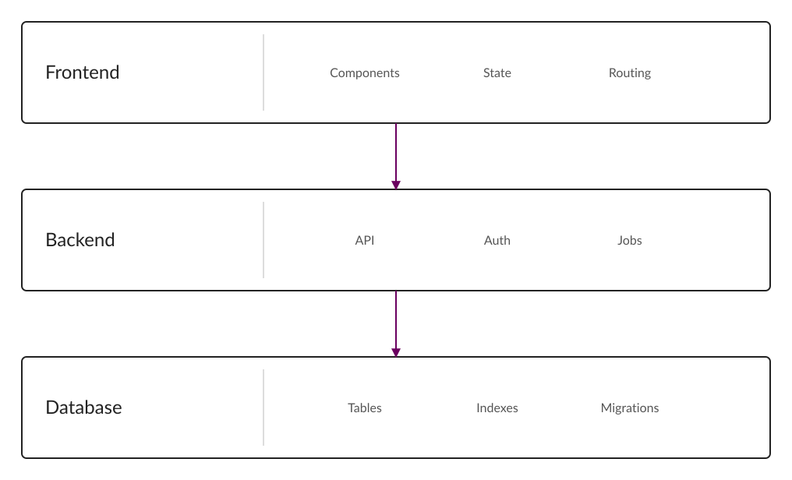
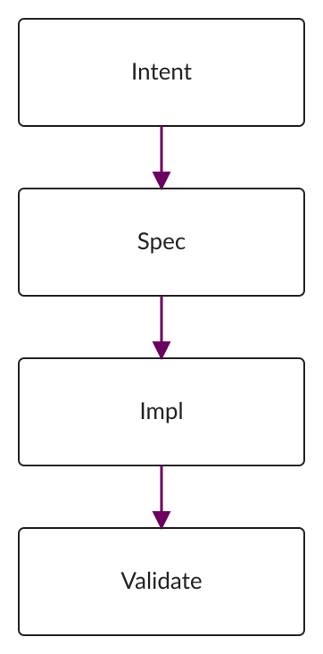
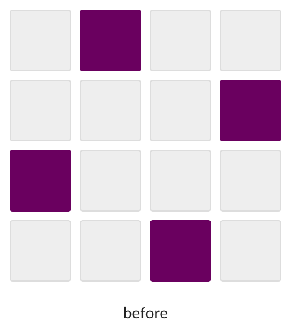
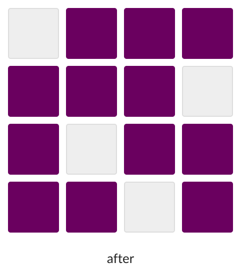

<!--
  模板用法：复制整个 templates/ 目录（deck.md + assets/），改名为你的报告。
  规则：Markdown 只写内容。字号、间距、配色、图片尺寸由 theme 和 layout engine 决定。
  分页：单独一行写 ---，并且前后各留一个空行。
  校验：写完执行 pnpm slides lint 你的文件.md
-->

<!-- layout: title -->

# 把它换成你的标题

## 一句话说清这份报告要回答什么

你的名字

你的单位

---

# 一页只讲一个观点

## 标题建议不超过 24 个中文字符

- 一级要点建议不超过 6 条
- 每条尽量一行写得完
- 内容再多就再分一页

需要展开时，可以再补一小段正文说明。

---

# 代码与引用

## 都是语义块，不需要手工排版

```js
export function greet(name) {
  return `hello, ${name}`;
}
```

> 引用适合放一句希望被记住的话。

---

# 公式

## 行内公式与独立公式都用 KaTeX

复杂度为 $O(n \log n)$，常数很小。

$$
T(n) = 2T(n/2) + O(n)
$$

---

# 表格

## 列不要太多，保证一屏能读完

| 阶段 | 产物        | 可编辑 |
| ---- | ----------- | ------ |
| 编写 | slides.md   | 是     |
| 渲染 | index.html  | 否     |
| 交付 | slides.pdf  | 否     |

---

# 横图会自动放到下方

## 文字少时，图片优先占满下半页

- 图片只写路径，不写宽高
- 永远按比例缩放，永不裁剪



---

# 竖图会自动放到右侧

## 自动变成左右分栏

- 竖图优先左右布局
- 正文约 56%，图片约 40%



---

# 两张图会自动并排

## 每张图占据同样的视觉面积





---

<!-- layout: middle -->

# 一个过渡页

---

<!--
  只有自动布局不理想时才需要手动指令，指令写在当前页最前面。
  可选 layout：auto / text / figure / image-right / image-left / image-bottom / gallery / middle / title
  image-width 只允许：30% 35% 40% 45% 50% 60% 70% 80% 90%
-->

<!-- layout: image-left -->

# 需要手动指定时

## 用指令改成图左文右

- 自动布局覆盖绝大多数情况
- 指令是例外，不是默认
- 不允许写像素、字号、边距、颜色


---

# 结尾

## 用一句可执行的话收尾

- 想讲的东西，写完先 lint 一次
- 装不下就拆页，不要缩字号

谢谢。
